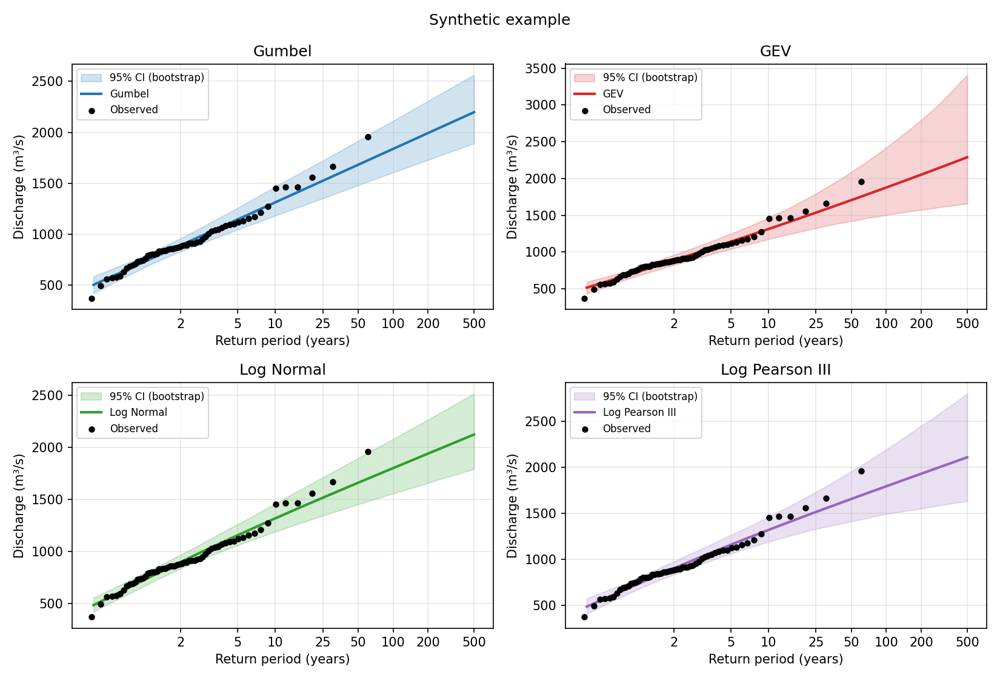

# floodfreq

### 👉 [**Open the web app**](https://biswashk920.github.io/Frequency_Analysis/): paste your data and get results in seconds. No install, nothing uploaded.

Flood frequency analysis for annual maximum discharge (m³/s) or rainfall (mm). It fits **Gumbel, GEV, Log Normal and Log Pearson III**, reports the 2, 5, 10, 25, 50, 100, 200 and 500-year events with bootstrap confidence bands, **tells you which model fits best**, and exports everything to an **Excel workbook**. The same analysis runs in your browser and from the command line.



## What you get

| | Web app | Command line |
|---|---|---|
| Return periods 2–500 yr with bootstrap bands | ✅ | ✅ |
| Model ranking (AIC, ΔAIC, Akaike weights, KS, RMSE, BIC) and a plain-language "which fits best" summary | ✅ | ✅ |
| Optional Mann-Kendall trend test | ✅ (checkbox) | ✅ (`--trend`) |
| Excel workbook with tables for every method | ✅ figures as embedded images | ✅ figures as **native, editable Excel charts** |
| Flood illustration (river cross-section and hydrograph animation) | ✅ | |
| CSV and PNG figures | CSV | ✅ |

Everything in the web app runs locally in your browser and the page loads no third-party resources, so your data never leaves your machine.

## Use it

**Web page:** use the [live app](https://biswashk920.github.io/Frequency_Analysis/) or open `docs/index.html` locally.

**Command line**
```bash
pip install -r requirements.txt            # or: pip install -e .
python -m floodfreq.cli examples/synthetic_peaks.csv --type discharge --station "My gauge" --trend
python -m floodfreq.cli --values "520 610 480 905 730 ..." --type rainfall --conf 0.9
```
Outputs go to `results/`: `floodfreq_results.xlsx`, `return_periods.csv`, `fit_statistics.csv`, `fit_<dist>.png`, `fit_all.png`, `compare.png`. Add `--no-xlsx` to skip the workbook, `--pp cunnane|gringorten` to change plotting positions, `--nboot` and `--conf` to change the bootstrap.

**Python**
```python
from floodfreq import analyze
res = analyze(values, conf=0.95, nboot=2000, trend=True)
print("\n".join(res["summary"]))
res["return_periods"], res["fit_statistics"]     # pandas DataFrames
```

**Input notes**
- One value per year. For a CSV, a year column (by name or content) is detected, used to sort the records chronologically, and never analysed as data. Choose another value column with `--column`.
- Numbers may be separated by spaces, newlines, semicolons or commas. `1,200` is read as 1200 and reported as a note; `520,610,480` is read as three values.
- Values must be positive, finite and not all identical; you need at least 5.

## The Excel workbook

| Sheet | Contents |
|---|---|
| Summary | Run settings, the "which model fits best" text, a ranking table, and the Mann-Kendall result if run |
| Return Periods | 2–500 yr estimate, lower and upper bound for each of the four methods |
| Fit Statistics | KS, RMSE, AIC, ΔAIC, Akaike weight, BIC, AIC rank, support check |
| Parameters | Fitted parameters with their meaning |
| Data | Your values, sorted values, plotting positions, empirical return periods and fitted quantiles |
| Curves | The fitted curves and bands used for the charts |
| Charts / Figures | One chart per method plus a comparison (native charts from the CLI, images from the web app) |

## Method

| Distribution | Fitting | Quantile |
|---|---|---|
| Gumbel | L-moments | x = ξ − α ln(−ln F) |
| GEV | L-moments (Hosking 1990), k clipped to ±0.5 | x = ξ + α/k [1 − (−ln F)^k] |
| Log Normal | mean and sd of ln x | x = exp(μ + σ z) |
| Log Pearson III | mean, sd and bias-corrected skew of log10 x (no regional skew); exact Pearson III distribution | log x = μ + K(g, F) σ |

Return period: T = 1 / (1 − F), for an annual maximum series. Bands are percentile intervals from a parametric bootstrap (default 2000 resamples in the CLI, 1000 in the browser, fixed seed). Plotting positions: Weibull by default, Cunnane and Gringorten available.

**Choosing a model.** AIC rewards fit and penalises parameters; lower is better, and the ΔAIC and Akaike weights show how much better. Models within ΔAIC < 2 are effectively tied, and the summary says so instead of naming a false winner. If an observation lies outside the range of a fitted distribution (possible for GEV and LP3 with a bounded tail), its likelihood is zero, so AIC/BIC are reported as unavailable for that model rather than silently infinite.

**Mann-Kendall (optional).** Tie-corrected Mann-Kendall test with Sen's slope, at the 5% level. It assumes the values are in chronological order and does not test or correct for serial correlation.

## Validation

```bash
pip install -r requirements-dev.txt
pytest -q
```
The tests cover parameter recovery, cdf/ppf round trips, plotting positions, goodness-of-fit and AIC (including the out-of-range case), Mann-Kendall against known values and SciPy, input parsing and validation, CSV year-column handling, the Excel workbook (sheets, native charts, values), the CLI, and a sanity check of band coverage.

`tests/test_js_parity.py` runs the browser code (`docs/floodfreq.js`) under Node.js and checks it against the Python package: return-period quantiles agree to a relative difference of 2e-6 across skewed, short, tied and out-of-range samples, and KS, RMSE, AIC, BIC, Akaike weights and Mann-Kendall statistics agree too. It also opens the browser-built Excel file to check its sheets, values and embedded images. (Bootstrap bands differ slightly between the two because the random number generators differ.)

`examples/synthetic_peaks.csv` is **synthetic** (60 values, assigned to the years 1961–2020 for demonstration only). To validate against a published record, add it to `examples/` and compare with the published return-period values.

## Limits

- **Bands are narrower than their label suggests.** They reflect sampling noise within each fitted model and nothing else. In a simulation (`scripts/coverage_simulation.py`: true GEV, n = 30, 100 replications, so roughly ±5 points), nominal 95% bands contained the true 100-year flood 89% of the time for GEV, 88% for LP3 and only 76% and 75% for Gumbel and Log Normal, which are the wrong model there. Differences between models (the "100-year estimate ranges from…" line in the summary) are a separate source of uncertainty.
- Short records (n < 30) make the 100–500 year estimates heavy extrapolation.
- Four models fitted to the same data are not independent evidence; a good fit over the observed range says little about the far tail.
- Not included: low-outlier tests, regional skew, historical-flood adjustment (Bulletin 17C / EMA), partial-duration series, non-stationary models, serial-correlation tests.
- KS p-values are deliberately not reported: with parameters estimated from the same data they are optimistic.
- The flood illustration shows the scale of the estimated flood against typical floods. It is not a hydraulic model.

## Repository layout

```
floodfreq/        Python package (fitting, bootstrap, screening, report, Excel export, CLI)
docs/             Web app: index.html, floodfreq.js (analysis), xlsxmini.js (Excel writer)
tests/            pytest suite and the Node.js parity harness
scripts/          Band-coverage simulation
examples/         Synthetic data and example outputs
```

## References

Hosking, J.R.M. (1990). L-moments: analysis and estimation of distributions using linear combinations of order statistics. *J. R. Stat. Soc. B* 52(1). ·
U.S. Interagency Advisory Committee on Water Data (1982). *Guidelines for Determining Flood Flow Frequency*, Bulletin 17B. ·
Mann, H.B. (1945). Nonparametric tests against trend. *Econometrica* 13. · Kendall, M.G. (1975). *Rank Correlation Methods*. · Sen, P.K. (1968). Estimates of the regression coefficient based on Kendall's tau. *JASA* 63. ·
Burnham, K.P. and Anderson, D.R. (2002). *Model Selection and Multimodel Inference*.

## License

MIT. See [LICENSE](LICENSE).
